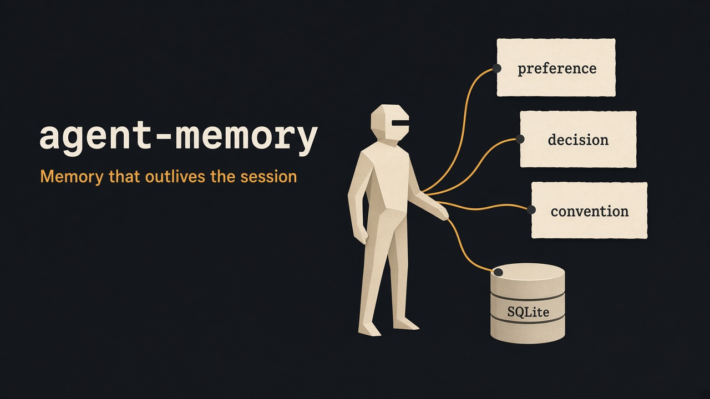
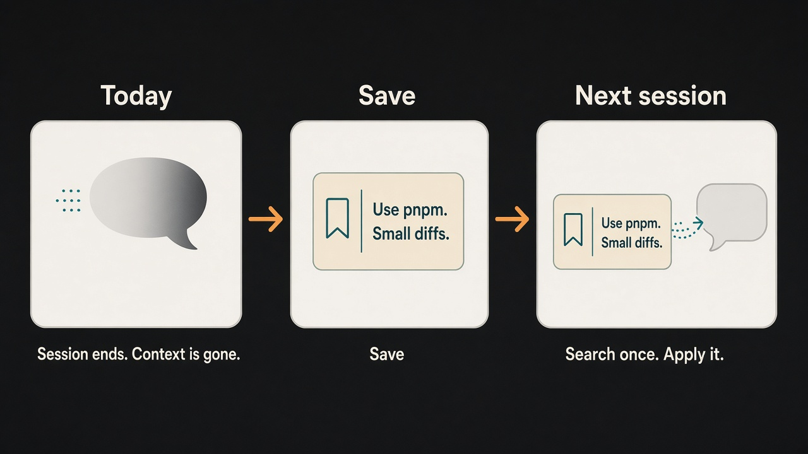
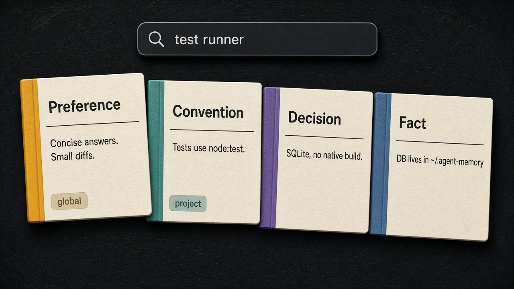
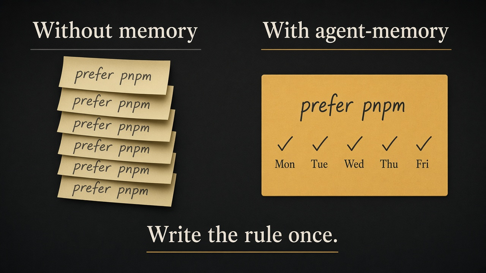
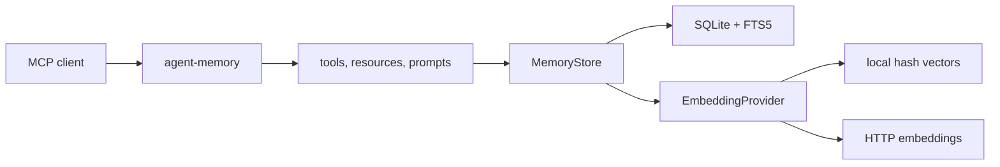

# agent-memory



Persistent memory for AI coding agents. One local MCP server remembers what your team already decided, and hands it back at the start of the next session.

Agents are brilliant inside a single chat and empty the moment that chat closes. agent-memory is the layer they write to and read from: preferences, conventions, decisions, facts, and notes, stored on your machine, scoped to a project or to the person, and returned as short cards that fit in a context window.

[](LICENSE)
[](https://nodejs.org)
[](https://modelcontextprotocol.io)

```bash
npm install && npm run build
node dist/index.js
```

No account. No native compiler. No database server to run. The file is SQLite, the protocol is [MCP](https://modelcontextprotocol.io), and the clients are the ones you already use: Cursor, Claude Desktop, Claude Code, Gemini CLI, Codex, and any other host that can launch a stdio server.

---

## The problem it removes

Every new agent session starts from zero.

- The human re-explains the package manager, the test command, the review style, and the words they do not want in a pull request.
- The agent re-reads the repo, guesses, and sometimes guesses wrong.
- A decision made on Tuesday is invisible on Wednesday.
- A preference that is true for every repo has to be restated inside every repo.
- A secret, a log dump, or a transcript gets pasted into a note because there was nowhere better to put a durable fact.

agent-memory gives the agent a place for the sentence that should still be true next week, and a search tool that finds it before the agent asks you again.



## What you can do with it

| Opportunity | How agent-memory does it |
| --- | --- |
| Stop repeating yourself | Save a preference once, at global scope. Every later session in every repo can search it. |
| Keep a repo consistent | Save conventions and decisions at project scope. The next chat in that repo sees them. |
| Separate clients or products | Each project name is its own shelf. A search in project A does not return project B. Global memories still ride along. |
| Brief a new model | The memory is plain text in SQLite. Swap Claude for another MCP client and the same memories are there. |
| Keep context small | Search and list return short cards. The full text is one `memory_get` away. |
| Trust a delete | `memory_clear` previews the count and deletes nothing until the agent sends the confirmation phrase back. |
| Keep secrets out | Private keys, `sk-` tokens, GitHub tokens, and assigned passwords are refused. Store a pointer: "The API key lives in .env." |
| Run it offline | The default embedder is local. Keyword search needs no network. |
| Upgrade search later | Point `AGENT_MEMORY_EMBEDDINGS=http` at Ollama or any OpenAI-compatible embeddings API. |
| Put it in front of a team | The database is one file. Point every developer at the same path if you want a shared shelf, or leave the default and each machine keeps its own. |
| Extend the backend | Tools talk to a `MemoryStore` interface. Another database can replace SQLite without changing the tools the agent sees. |



## Where the time goes

The saving is not a benchmark we invented. It is the briefing you currently repeat.

A durable rule takes a minute or two to state the first time: which package manager, how tests run, how small a diff should be, which words to avoid. Without memory, that minute comes back every session. With memory, it is written once and searched in a tool call.

A planning example you can scale for your own team:

| | One person | A team of 8 |
| --- | --- | --- |
| Agent sessions in a week | 8 | 64 |
| Minutes to restate the same three rules | 3 | 3 |
| Human minutes spent restating | 24 | 192 |
| After the rules live in memory | one search per session | one search per session |

Three minutes, eight times a week, is **24 minutes a week** for one person: about an hour and a half a month. The same habit across a team of eight is **192 minutes a week**: about 13 hours a month, spent only on re-briefing. That count does not include the slower part: the agent re-discovering a convention by reading the repo, choosing the wrong library, and waiting for a review comment. Those loops are the expensive ones, and they shrink when the decision is already a memory of importance 5.



What that looks like in a business:

- **A product team** stops re-litigating "we use pnpm" and "tests are node:test" inside every chat. Reviews talk about the change, not the house style.
- **A founder** keeps one global preference for tone and diff size, and one project shelf per product. The agent does not mix them.
- **An agency** gives each client a project name. Client A's deploy rule never appears in client B's search.
- **A platform group** stores the security rules once, at global scope, importance 5. Every repo's agent is expected to search before it adds a dependency.
- **Onboarding** gets shorter. A new teammate's agent can list the project decisions instead of reconstructing them from old pull requests.

The memory does not replace your docs. It holds the sentences an agent must apply before it writes code.

## Memory, in one picture

Five types. Two scopes. One importance scale.

| Type | Save it when | Default importance |
| --- | --- | --- |
| `preference` | The person has a standing taste. Tone, tools, review style. | 4 |
| `decision` | A choice was made. Library, architecture, tradeoff. | 4 |
| `convention` | This repo has a rule. Naming, tests, layout. | 4 |
| `fact` | Something stable is true. Where the database lives, who owns a service. | 3 |
| `note` | A short reminder that is not a rule. | 2 |

Importance is an integer from **1** (trivia) to **5** (apply this without being asked). Search ranks importance alongside the match, so a rule you marked 5 surfaces above a casual note.

Scope is the other half:

- **`project`** belongs to one repo. The default project is `AGENT_MEMORY_PROJECT`, or the folder name of the git root when the client launches the server inside the workspace.
- **`global`** belongs to the person and is included in project searches unless you turn that off.

Same sentence, two projects: two memories. Same sentence, same scope, same type: one memory. A second save merges tags and raises importance if the new value is higher.

## Every tool

Search and list return cards. `memory_get` returns the full text. Every tool also returns structured JSON, so a client can render it or an agent can chain it.

### `memory_add` — save one durable sentence

Use it when something should still be true next week. One statement. The rule itself, not the meeting that produced it.

```json
{
  "content": "User prefers concise explanations and small diffs.",
  "type": "preference",
  "importance": 5,
  "scope": "global",
  "tags": ["style"]
}
```

| Field | What it does |
| --- | --- |
| `content` | Required. Up to 16,000 characters. Longer memories are rejected so the agent splits them. |
| `title` | Optional. Defaults to the first sentence. Max 140 characters. |
| `type` | Optional. Inferred from the wording when you omit it. "We decided…" becomes a decision. "In this repo…" becomes a convention. |
| `importance` | Optional. 1 through 5. The default follows the type. |
| `scope` | `project` or `global`. A known project name selects `project`. |
| `project` | Optional name, 1–80 characters. Defaults to the configured project. |
| `tags` | Up to 12 labels. Normalized to lowercase. Inferred from identifiers in the text when omitted. |
| `category` | Optional bucket such as `testing` or `git`. Max 40 characters. |
| `source` | Where it came from, such as `user` or a file path. Max 160 characters. |

Memories longer than about 320 characters get a short summary. List and search show the summary. Get shows the original.

A likely secret is rejected: a private key block, an `sk-` key, a `ghp_` / `github_pat_` token, an AWS access key id, a Slack token, or a password assigned to a long or mixed value. The message tells the agent to store a reference instead.

### `memory_search` — look before you guess

Call this at the start of project work, and whenever someone says "as usual", "last time", or "we decided".

```json
{ "query": "how do we run tests?", "limit": 5 }
```

| Field | What it does |
| --- | --- |
| `query` | Required. Two to 500 characters. Short and specific beats a paragraph. |
| `mode` | `hybrid` (default), `keyword`, or `semantic`. |
| `limit` | 1–25. Default 8, so the answer stays small. |
| `type`, `category`, `tags` | Narrow the shelf. |
| `min_importance` | Drop anything below this level. |
| `scope` | `project` or `global`. Omit it to use the default project. |
| `project` | Override the project name for this call. |
| `include_global` | When a project is selected, also return global memories. Default `true`. |

Hybrid mode blends a keyword score with a vector score, then nudges the rank with importance and recency. Keyword mode uses FTS5 (Porter stemming, so "testing" finds "tests"). Semantic mode uses embeddings only. If the embedding service is off or down, search says so and returns keyword hits.

An empty result tells the agent to try fewer words or to browse with `memory_list`.

### `memory_get` — read the full text

```json
{ "id": "mem_ab12cd34ef567890" }
```

Returns the title, body, type, scope, tags, category, source, and timestamps. Reading a memory records that it was used.

### `memory_list` — browse the shelf

Use this to see what is stored. Use search when you have a question.

```json
{ "type": "decision", "sort": "importance", "limit": 10 }
```

| Field | What it does |
| --- | --- |
| `limit` | 1–50. Default 20. |
| `offset` | Skip this many matches. Default 0. |
| `sort` | `recent` (default) or `importance`. |
| filters | Same type, category, tag, importance, scope, and project filters as search. |

The text says "8 of 23 memories" so the agent knows there is another page.

### `memory_update` — change a decision in place

When a choice changes, update the old memory. A second, contradicting memory is how a shelf goes stale.

```json
{
  "id": "mem_ab12cd34ef567890",
  "content": "Tests use node:test. Do not add Jest.",
  "importance": 5
}
```

Pass only the fields that should change. You can clear `category` or `source` with `null`. Moving a memory onto text that already exists in the same scope and type returns a conflict and the id of the existing row.

### `memory_delete` — remove one memory

```json
{ "id": "mem_ab12cd34ef567890" }
```

One id. It cannot be undone. A missing id is an error, not a silent success.

### `memory_clear` — delete a set, with a lock

The first call never deletes. It counts, names the scope, and returns the exact phrase that will authorize the delete.

```json
{ "scope": "project", "project": "my-app", "include_global": false }
```

```text
Would delete 2 memories (project my-app). Nothing was deleted.
To delete them, call memory_clear again with the same arguments and confirm: "DELETE MATCHING MEMORIES".
```

The follow-up:

```json
{
  "scope": "project",
  "project": "my-app",
  "include_global": false,
  "confirm": "DELETE MATCHING MEMORIES"
}
```

Wiping the whole file requires both `all: true` and `confirm: "DELETE ALL MEMORIES"`. A call with no scope and no `all` flag is refused. Filters and `all` together are refused, so a typo cannot widen into a full wipe.

### `memory_stats` — see the shape of the shelf

Counts by type, by scope, and by project, plus whether full-text search is on and which embedding model is active. The database path is in the response, so an agent can tell a human where the file lives.

## Resources and prompts

Hosts that read resources and prompts get four extra handles. The tools are enough on their own.

| Name | Kind | What the agent receives |
| --- | --- | --- |
| `memory://guide` | Resource | A short guide: when to search, when to save, how to write one memory, how deletes work. |
| `memory://recent` | Resource | The newest memories for the current project plus global scope, as markdown. |
| `recall-context` | Prompt | Argument `task`. Instructs the agent to search, read anything thin, apply what it finds, and save a new decision if one is made. |
| `capture-memories` | Prompt | Argument `notes`. Instructs the agent to keep only durable sentences and to search before it writes, so a contradiction becomes an update. |

Capable hosts also inject the server instructions: search first, save only what should survive the week, never store a secret, and treat `memory_clear` as a two-step lock.

## A session, end to end

1. Monday. The user says tests in this repo must use node:test, and they want small diffs in every repo.
2. The agent saves two memories.
   - Convention, project `billing-api`, importance 5: "Tests use node:test. Do not add Jest."
   - Preference, global, importance 4: "User prefers concise explanations and small diffs."
3. Tuesday, a new chat, same repo. The user asks for a test of the refund path.
4. The agent calls `memory_search` with `"test runner"`. The convention card comes back. The global preference comes back with it.
5. The agent writes a node:test file and a short diff. It does not ask which runner to use.
6. Thursday the team switches the runner. The agent calls `memory_update` on the old id. There is still one convention, and it is the current one.
7. Next month a different repo is opened. Search for "diffs" still returns the global preference. Search for "node:test" does not return the billing-api convention, because that memory is project scoped.

`npm run seed` loads six memories in this shape so you can try the search before you have written your own.

## How an agent should write

- Search before saving. The add tool dedupes identical text, and update is how a decision moves.
- One memory, one sentence a stranger could apply. "Use pnpm. Do not add a package-lock.json."
- Keep the person's wording when they stated a rule.
- Global is the person. Project is this repo. A tone preference is usually global. A test command is usually project.
- Importance 5 means "apply this without being asked." Importance 1 is trivia.
- Skip chatter, stack traces, diffs, and anything that will be stale tomorrow.
- Read the card. Call `memory_get` only when the preview is not enough.
- Store "the API key lives in .env", never the key.

## Install

Node.js 22.13 or newer.

```bash
git clone https://github.com/imranbru99/mcp-agent-memory.git
cd mcp-agent-memory
npm install && npm run build
```

The server waits on stdin. An MCP client starts it. You can also run it yourself to confirm the process:

```bash
node dist/index.js
```

While you are changing the source, skip the build:

```bash
npx tsx src/index.ts
```

Load the examples into the configured database:

```bash
npm run seed
```

Useful checks:

```bash
node dist/index.js path     # where the SQLite file is
node dist/index.js stats    # counts as JSON
node dist/index.js help
```

Logs go to stderr. stdout is the protocol stream. A `console.log` in a fork of this server would corrupt the connection.

## Connect it

Replace the path with the absolute path on your machine. Set `AGENT_MEMORY_PROJECT` when the host does not start the process inside the repo. Cursor and Claude Code usually use the workspace as the working directory, and the server then takes the git root folder name.

### Cursor

`.cursor/mcp.json` in the project, or `~/.cursor/mcp.json` for every project:

```json
{
  "mcpServers": {
    "agent-memory": {
      "command": "node",
      "args": ["/absolute/path/to/agent-memory/dist/index.js"],
      "env": {
        "AGENT_MEMORY_PROJECT": "my-app"
      }
    }
  }
}
```

### Claude Desktop

| OS | Config file |
| --- | --- |
| macOS | `~/Library/Application Support/Claude/claude_desktop_config.json` |
| Linux | `~/.config/Claude/claude_desktop_config.json` |
| Windows | `%APPDATA%\Claude\claude_desktop_config.json` |

```json
{
  "mcpServers": {
    "agent-memory": {
      "command": "node",
      "args": ["/absolute/path/to/agent-memory/dist/index.js"],
      "env": {
        "AGENT_MEMORY_PROJECT": "my-app"
      }
    }
  }
}
```

Restart Claude Desktop after saving.

### Claude Code

From the project directory:

```bash
claude mcp add agent-memory -- node /absolute/path/to/agent-memory/dist/index.js
```

Or a project `.mcp.json`:

```json
{
  "mcpServers": {
    "agent-memory": {
      "command": "node",
      "args": ["/absolute/path/to/agent-memory/dist/index.js"]
    }
  }
}
```

### Gemini CLI, Codex, and any other stdio host

The same command and the same environment variables. If the host has an `mcpServers` map, it looks like the Cursor example. If it has a TOML or YAML table, the fields are still `command`, `args`, and `env`.

After it is connected, ask the agent to call `memory_stats`. A count and a database path mean the server is live.

## Configuration

Environment variables win over `~/.agent-memory/config.json`. If `AGENT_MEMORY_CONFIG` points at a file, that file must exist and must be a JSON object. A missing default config file is ignored.

| Variable | Default | Purpose |
| --- | --- | --- |
| `AGENT_MEMORY_DB` | `~/.agent-memory/memory.db` | SQLite file. `~` is expanded. |
| `AGENT_MEMORY_PROJECT` | Git root folder name, or unset | Default project. An empty value forces "no project", so new memories are global unless a call sets one. |
| `AGENT_MEMORY_EMBEDDINGS` | `local` | `local`, `off`, or `http`. |
| `AGENT_MEMORY_EMBEDDING_URL` | unset | OpenAI-compatible `POST /embeddings` URL. Required when embeddings is `http`. |
| `AGENT_MEMORY_EMBEDDING_MODEL` | `text-embedding-3-small` | Model field sent to that URL. |
| `AGENT_MEMORY_EMBEDDING_API_KEY` | unset | Bearer token. A local Ollama server does not need one. |
| `AGENT_MEMORY_LOG` | `info` | `debug`, `info`, `warn`, or `error`. |
| `AGENT_MEMORY_CONFIG` | `~/.agent-memory/config.json` | Optional JSON file. |

```json
{
  "database": "~/.agent-memory/memory.db",
  "project": "my-app",
  "embeddings": "local",
  "logLevel": "info"
}
```

HTTP embeddings, for a stronger semantic match than the local vectors:

```bash
AGENT_MEMORY_EMBEDDINGS=http \
AGENT_MEMORY_EMBEDDING_URL=http://127.0.0.1:11434/v1/embeddings \
AGENT_MEMORY_EMBEDDING_MODEL=nomic-embed-text \
node dist/index.js
```

If that service is down, the write still succeeds, the tool says the embedding was not saved, and keyword search keeps working. Vectors from different models are never compared with each other. Switching models does not corrupt old rows; those rows simply wait for a keyword hit or a later rewrite.

The database directory is created on startup. On-disk files use WAL so a reader and a writer can share the file. Busy waits are capped at five seconds.

## Architecture



The tools know nothing about SQL. They call `MemoryStore` in `src/store.ts`. `SqliteMemoryStore` is the built-in implementation. A hosted database or a sqlite-vec index would be a second class behind the same methods: add, get, update, delete, list, search, count, clear, stats.

What the SQLite backend does today:

- **One file, no addon.** Storage is Node's `node:sqlite`. Install does not need Python, make, or a C++ toolchain.
- **Keyword search.** FTS5 with the Porter stemmer when this Node build includes it. Otherwise a bounded `LIKE` scan. Current Node 22 releases include FTS5. "testing" matches "tests".
- **Vectors.** Each memory can store a float32 blob. Search computes cosine similarity in process over the filtered rows, capped at 5,000. That is the right cost for a personal or team shelf of thousands of short memories, and it avoids a native extension.
- **Local embeddings** (`local-hash-v1`). Hashed tokens, character trigrams, light stemming, and a small coding synonym list, so "TypeScript" sits near "ts" and "prefers" sits near "preference". This is a local vector index, not a neural model. Use HTTP embeddings when you want a model.
- **Schema version 1** in the `meta` table. A newer, incompatible file fails with a clear error instead of guessing.
- **The MCP SDK** is `@modelcontextprotocol/server`, the current TypeScript line for the 2026-07-28 spec, over stdio. The older package name `@modelcontextprotocol/sdk` is the v1 line.

Ids look like `mem_` plus time and random bytes, so they are short enough to pass back into `memory_get`.

## Safety

- Mass delete is a two-step lock. The preview and the phrase are the whole safety check. There is no hidden confirm.
- A single `memory_delete` is immediate, and it names the id it removed.
- Secret-shaped content is rejected on add and on update.
- Logs record ids, types, and counts. They do not record memory text at info level.
- The process does not phone home. The only outbound call is the embeddings URL you configure.

## What lives where in the repo

| Path | Role |
| --- | --- |
| `src/index.ts` | CLI: serve, `path`, `stats`, `help` |
| `src/server.ts` | MCP tools, resources, and prompts |
| `src/store.ts` | `MemoryStore` and the SQLite backend |
| `src/prepare.ts` | Scope, tags, summaries, secret checks, embeddings on write |
| `src/embedding.ts` | Local vectors, disabled mode, HTTP provider |
| `src/guide.ts` | The instructions hosts show the agent |
| `examples/memories.json` | Sample shelf |
| `test/` | Store, language, and a real in-memory MCP client |

## Development

```bash
npm test
npm run typecheck
npm run build
```

The tests cover add, dedupe, project isolation, stemmed keyword search, semantic ranking, tag filters, update conflicts, the clear lock, secret rejection, and an MCP client calling every tool.

## License

MIT. See [LICENSE](LICENSE).

Use it, fork it, and point your agents at it. The shelf is yours. It stays on the machine you choose.

## Let's connect and collaborate

I am open to Senior Remote Full-Stack Roles, AI Platform Architecture Contracts, and Enterprise Technical Advisory.

**Timezone:** UTC+6 (Dhaka / Rangpur, Bangladesh). Flexible overlap with US, UK, and European business hours.

**Delivery:** Async-ready. Slack, Discord, Jira, GitHub, and production-first accountability.

| Channel | Address | Action |
| --- | --- | --- |
| Primary portfolio | [imrandev.bd](https://imrandev.bd) | [Visit site](https://imrandev.bd) |
| Packagist packages | [packagist.org/packages/imrandevbd](https://packagist.org/packages/imrandevbd/) | [View packages](https://packagist.org/packages/imrandevbd/) |
| LinkedIn | [linkedin.com/in/imranbru99](https://www.linkedin.com/in/imranbru99) | [Connect](https://www.linkedin.com/in/imranbru99) |
| GitHub | [github.com/imranbru99](https://github.com/imranbru99) | [Follow](https://github.com/imranbru99) |
| WhatsApp | [+880 1576-918420](https://wa.me/8801576918420) | [Chat now](https://wa.me/8801576918420) |
| Email | [me@imrandev.bd](mailto:me@imrandev.bd) | [Send email](mailto:me@imrandev.bd) |
| X (Twitter) | [@imrandev_bd](https://x.com/imrandev_bd) | [Follow](https://x.com/imrandev_bd) |
| YouTube | [@ImranDevBD](https://www.youtube.com/@ImranDevBD) | [Subscribe](https://www.youtube.com/@ImranDevBD) |
